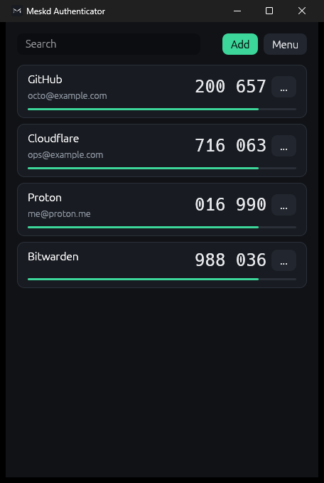

<p align="center">
  
</p>

<h1 align="center">Meskd Authenticator</h1>

<p align="center">Two-factor codes on your desktop. Offline, encrypted, no account.</p>

<p align="center">
  
</p>

## Download

Get the latest build from [Releases](https://github.com/MESKD-INTELLIGENCE/meskd-auth/releases/latest).

- **Windows 10 and 11**: unzip and run `meskd-auth.exe`.
- **Linux x86_64** (Ubuntu 22.04+, Debian 12+, Fedora, Arch): extract, then run `./install.sh` to add it to your app menu, or start `./meskd-auth` directly.

## What it does

- Time-based (TOTP) and counter-based (HOTP) codes, SHA1, SHA256 and SHA512, 6 to 8 digits
- Add accounts from a QR code image, a pasted screenshot, an `otpauth://` link or the setup key a website shows
- Import Google Authenticator exports
- Export to an encrypted backup, a plain list of `otpauth://` links, or QR codes Google Authenticator can scan
- Click an account to copy its code. The clipboard is cleared after 30 seconds and kept out of Windows clipboard history
- Locks itself after 5 minutes without input

## Adding an account

When a website shows a QR code for two-factor setup, either save or screenshot it and press <kbd>Ctrl</kbd>+<kbd>V</kbd>, or copy the setup key printed next to it and press <kbd>Ctrl</kbd>+<kbd>V</kbd>. The app shows the current code so you can finish setup on the website.

## Moving from Google Authenticator

1. In Google Authenticator, open **Transfer accounts**, then **Export accounts**.
2. Google Authenticator blocks screenshots of that screen, so take a photo of each QR code with another device.
3. Drop the photos on the Meskd Authenticator window, or use **Menu > Import from file**.

## Security

- Everything stays on your computer. The app has no network code.
- The vault is encrypted with XChaCha20-Poly1305 under a key derived from your password with Argon2id (64 MiB, 3 passes). The file header is authenticated too, and every save uses a fresh nonce.
- Saves are atomic, so a crash or power loss cannot leave a half-written vault.
- Secrets are wiped from memory when the vault locks.
- Codes come from your system clock. Leave automatic time sync on.

The vault lives in `%APPDATA%\Meskd Authenticator` on Windows and `~/.local/share/meskd-auth` on Linux. Use `--vault <file>` to keep it somewhere else.

See [SECURITY.md](SECURITY.md) for the threat model and how to report a problem.

## Building

Rust 1.95 or newer.

```sh
cargo build --release
```

On Linux you also need the X11 and Wayland headers:

```sh
sudo apt install libxkbcommon-dev libwayland-dev libx11-dev
```

## License

[MIT](LICENSE)
